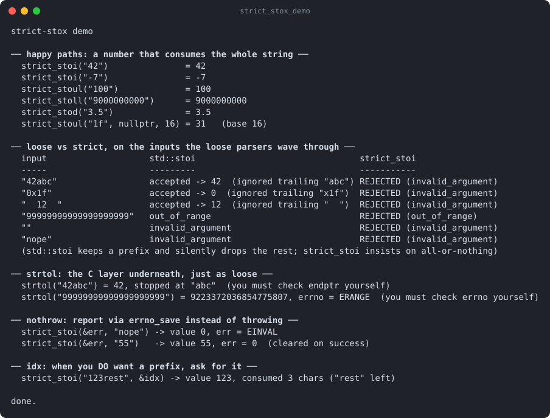

# strict-stox

Part of [Kronuz C++ Libraries](https://github.com/Kronuz/cpp-libraries), a collection of small, reusable C++ libraries.

[](https://github.com/Kronuz/strict-stox/actions/workflows/ci.yml)
[](LICENSE)


Strict number parsing for C++20: `strict_stoi("42abc")` is an error, not `42`.
The whole string must be a number unless you ask for a prefix, overflow is an
error, and a no-throw form reports through `errno`. For configuration, query
strings, and anything users type.



## ✨ Highlights

- **Strict by default.** Trailing garbage throws `std::invalid_argument`;
  overflow throws `std::out_of_range`.
- **Prefixes on request.** Pass `idx` to parse a prefix and learn where it ended.
- **No-throw form.** `strict_stoi(&err, "nope")` sets `err` to `EINVAL` or `ERANGE`.
- **The whole family**: `strict_stoi`, `stou`, `stol`, `stoul`, `stoll`,
  `stoull`, `stoz` (to `size_t`), `stof`, `stod`, `stold`, taking
  `std::string_view`, with a base for the integer ones.
- **One header, no dependencies.**

## 📦 Installation

Requires a C++20 compiler; CMake 3.14 or newer for the CMake route. CI builds it
on Linux (x86_64, arm64), macOS (arm64, x86_64), and FreeBSD, plus ASan, UBSan,
and TSan builds.

```cmake
include(FetchContent)
FetchContent_Declare(strict_stox
  GIT_REPOSITORY https://github.com/Kronuz/strict-stox.git
  GIT_TAG        main)
FetchContent_MakeAvailable(strict_stox)

target_link_libraries(my_app PRIVATE strict_stox::strict_stox)
```

Or copy `strict_stox.hh` onto your include path.

## 🚀 Quick start

```cpp
#include "strict_stox.hh"

#include <cstdio>

int main() {
	int port = strict_stoi("8080");                  // 8080
	unsigned long mask = strict_stoul("1f", nullptr, 16);   // 31

	int err = 0;
	strict_stoi(&err, "8080/tcp");                   // err == EINVAL: not a whole number
	std::printf("%d %lu %d\n", port, mask, err);
}
```

[`examples/demo.cc`](examples/demo.cc) contrasts it with `std::stoi` on bad input.

## 🎯 When to use it

- ✅ Parsing numbers from users, files, or the network, where `"42abc"` must fail.
- ❌ Locale-aware or grouped input (`"1,000"`): it uses the C `strto*` rules.

## ⚡ Performance

Plain input is parsed directly, with no buffer copy and no `errno` traffic. Everything
else goes through `strto*`, with the same results, `errno` values, `idx` and exceptions.

- Integers: an optional `-` and digits of the base that do not overflow.
- `stod` and `stof`: `[-]digits[.digits][e[+-]digits]` of any length. The digits are read
  eight at a time. Short numbers take Clinger's exact multiply or divide. The rest (17
  digit doubles, long mantissas) take a 5 KB table of the 64 leading bits of the powers of
  five and one 64-bit multiply, rounded to nearest. A rounding the table cannot decide
  (about one 17 digit text in a thousand), a subnormal or overflowing result, `inf`,
  `nan`, hex floats and a rounding mode other than to-nearest go to `strtod`.

`ctest` checks both paths against libc and the frozen previous header; the floating
point path also against `std::from_chars`, on the exact halfway point of every binade,
the classic hard cases and random text (`test/fp_test.cc`, `tools/fp_mutants.py`), in each
of the four rounding modes (`test/rounding_test.cc`) and around the decimal point guard
(`test/locale_test.cc`).

**The decimal point.** `strtod` reads the locale's decimal point, so in a locale where it
is `,`, `strict_stod("1.5")` is `1` plus trailing text. The fast path keeps that: it asks
`nl_langinfo` before it reads a `.` (3 ns on Apple silicon, 5 ns on the Intel laptop). A
program that never leaves the `"C"` locale can skip the question with
`-DSTRICT_STOX_C_LOCALE` (CMake: `-DSTRICT_STOX_C_LOCALE=ON`): plain decimals are then
read with `.` in every locale. Both columns are below.

Floating point, ns per element, best of 9 under `quiet strict`, `-O3`, Apple clang 17,
mean of two runs (one for the Intel C locale column). `fast_float` moves by up to 10%
between builds, so its best result is shown. The C locale column skips the decimal point
query (above).

| workload | strict-stox | C locale | `fast_float` |
|---|---|---|---|
| **Apple M4 Pro** | | | |
| `stod`, short (`12345.678`) | 8.7 | **5.9** | 7.5 |
| `stod`, 17 digits (`%.17g`) | 10.8 | **7.2** | 10.6 |
| `stod`, shortest repr (JSON) | 10.9 | **8.5** | 10.4 |
| `stod`, 25-40 digits | 20.3 | **18.6** | 29.6 |
| `stod`, 100 digits | 28.7 | **27.1** | 37.7 |
| `stod`, 800 digits | 138 | 134 | **130** |
| `stof`, short | 9.2 | **7.5** | 9.8 |
| `stof`, 9 digits | 6.8 | **5.8** | 7.6 |
| `stof`, 25-40 digits | 23.6 | **22.9** | 28.9 |
| **Intel i9-9980HK** | | | |
| `stod`, short | 19.1 | **13.4** | 15.3 |
| `stod`, 17 digits | 25.2 | **19.9** | 23.2 |
| `stod`, shortest repr (JSON) | 32.9 | **24.0** | 27.8 |
| `stod`, 25-40 digits | 66.8 | **58.8** | 74.1 |
| `stod`, 100 digits | 79.1 | **69.8** | 80.4 |
| `stod`, 800 digits | 262 | 257 | 257 |
| `stof`, short | 22.6 | **17.5** | 20.2 |
| `stof`, 9 digits | 20.4 | **16.7** | 18.0 |
| `stof`, 25-40 digits | 77.6 | 69.6 | **68.3** |

Integers, Apple M4 Pro, Apple clang 17 with `-O3 -DNDEBUG -std=gnu++20`, ns per element
(mean of two runs under `quiet strict`; each run is the best of 9 samples over a pool of
1024 inputs):

| workload | strict-stox | `std::from_chars` |
|---|---|---|
| `stoi`, 1-9 digits | 6.4 | 7.2 |
| `stoull`, 1-19 digits | 6.5 | 8.8 |
| `stoul`, base 16 | 5.3 | 11.0 |

```sh
cmake -B build -DCMAKE_BUILD_TYPE=Release -DSTRICT_STOX_BUILD_BENCH=ON \
  -DCMAKE_CXX_FLAGS="-DHAVE_FAST_FLOAT -I/path/to/fast_float/include"
cmake --build build && ./build/strict_stox_bench
```

The `absl` column appears when abseil is installed, and the `fast_float` ones need
`-DHAVE_FAST_FLOAT` and its include path. The floating point rows above come from
`./build/strict_stox_bench fp` (the CMake build finds `fast_float` with
`-DSTRICT_STOX_FAST_FLOAT_DIR=/path/to/fast_float/include`); `-DHAVE_PREV` adds the
"before" column from a saved older header (see `bench/bench.cc`). The `fast%` column is
the share of a row's inputs that the fast path takes: a row whose inputs mostly go to
`strtod` measures `strtod`.

[CHANGELOG.md](CHANGELOG.md) has the timings before each change.

## 📚 Documentation

- [docs/API.md](docs/API.md): the functions, `idx`, and the no-throw form.
- [ARCHITECTURE.md](ARCHITECTURE.md): how the wrappers are generated.
- [AGENTS.md](AGENTS.md): repository map and traps.
- [CHANGELOG.md](CHANGELOG.md): what changed, and when.

## 🛠️ Building and testing

```sh
cmake -B build && cmake --build build && ctest --test-dir build
./build/strict_stox_demo
```

## 🤝 Contributing

Issues and pull requests are welcome. Read [AGENTS.md](AGENTS.md) first. CI must
pass on every platform.

## 📄 License

MIT, Copyright (c) 2015-2019 Dubalu LLC. See [LICENSE](LICENSE). Extracted from
[Xapiand](https://github.com/Kronuz/Xapiand).
