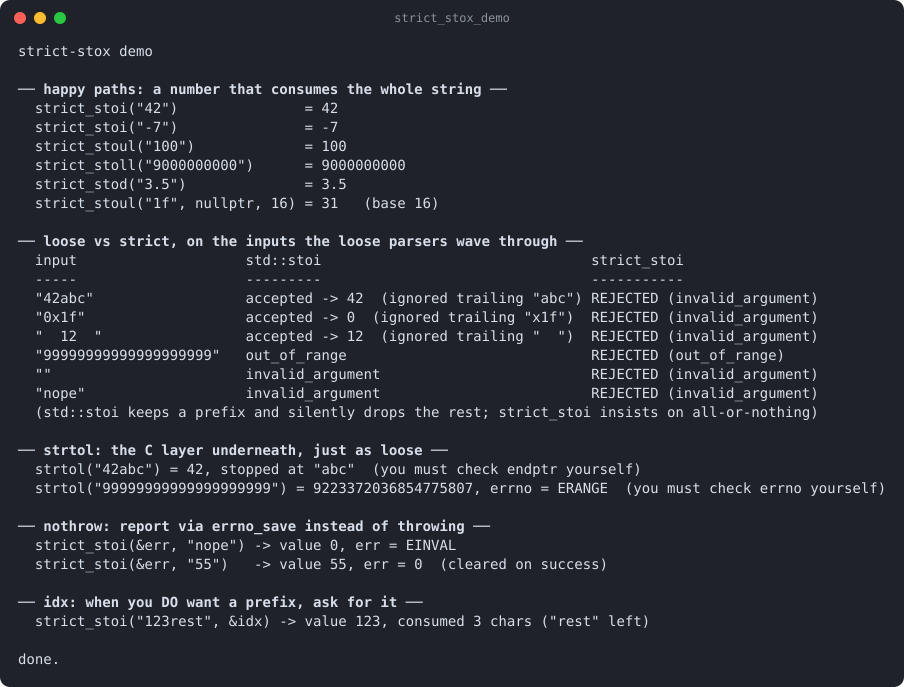

# strict-stox

Part of [Kronuz C++ Libraries](https://github.com/Kronuz/cpp-libraries), a collection of small, reusable C++ libraries.

[](https://github.com/Kronuz/strict-stox/actions/workflows/ci.yml)
[](LICENSE)


Strict number parsing for C++20: `strict_stoi("42abc")` is an error, not `42`.
The whole string must be a number unless you ask for a prefix, overflow is an
error, and a no-throw form reports through `errno`. For configuration, query
strings, and anything users type.



## ✨ Highlights

- **Strict by default.** Trailing garbage throws `std::invalid_argument`;
  overflow throws `std::out_of_range`.
- **Prefixes on request.** Pass `idx` to parse a prefix and learn where it ended.
- **No-throw form.** `strict_stoi(&err, "nope")` sets `err` to `EINVAL` or `ERANGE`.
- **The whole family**: `strict_stoi`, `stou`, `stol`, `stoul`, `stoll`,
  `stoull`, `stoz` (to `size_t`), `stof`, `stod`, `stold`, taking
  `std::string_view`, with a base for the integer ones.
- **One header, no dependencies.**

## 📦 Installation

Requires a C++20 compiler; CMake 3.14 or newer for the CMake route. CI builds it
on Linux (x86_64, arm64), macOS (arm64, x86_64), and FreeBSD, plus ASan, UBSan,
and TSan builds.

```cmake
include(FetchContent)
FetchContent_Declare(strict_stox
  GIT_REPOSITORY https://github.com/Kronuz/strict-stox.git
  GIT_TAG        main)
FetchContent_MakeAvailable(strict_stox)

target_link_libraries(my_app PRIVATE strict_stox::strict_stox)
```

Or copy `strict_stox.hh` onto your include path.

## 🚀 Quick start

```cpp
#include "strict_stox.hh"

#include <cstdio>

int main() {
	int port = strict_stoi("8080");                  // 8080
	unsigned long mask = strict_stoul("1f", nullptr, 16);   // 31

	int err = 0;
	strict_stoi(&err, "8080/tcp");                   // err == EINVAL: not a whole number
	std::printf("%d %lu %d\n", port, mask, err);
}
```

[`examples/demo.cc`](examples/demo.cc) contrasts it with `std::stoi` on bad input.

## 🎯 When to use it

- ✅ Parsing numbers from users, files, or the network, where `"42abc"` must fail.
- ❌ Locale-aware or grouped input (`"1,000"`): it uses the C `strto*` rules.

## ⚡ Performance

Plain input (an optional `-`, digits, and for floating point a fraction/exponent
that a single correctly rounded multiply or divide can handle) is parsed directly,
with no buffer copy and no `errno` traffic; everything else goes through `strto*` as
before, with identical results, `errno` values, `idx` and exceptions. On Apple silicon (Apple clang 17, -O3), ns per element, previous header to now
(`std::from_chars` for reference): `stoi` 1-9 digits 19.5 to 6.0 (7.0), `stoull` 1-19 digits
26.6 to 6.5 (8.5), `stoul` base 16 25.8 to 4.7 (10.5), `stod` of short decimals 19.0 to 10.2
(15.6; `fast_float` 7.5). Full-precision 17-digit doubles still take the `strto*` path
(26.2 to 24.3).
Run it with `cmake -B build -DSTRICT_STOX_BUILD_BENCH=ON && cmake --build build && ./build/strict_stox_bench`;
`ctest` also runs a differential test against the previous header.

## 📚 Documentation

- [docs/API.md](docs/API.md): the functions, `idx`, and the no-throw form.
- [ARCHITECTURE.md](ARCHITECTURE.md): how the wrappers are generated.
- [AGENTS.md](AGENTS.md): repository map and traps.

## 🛠️ Building and testing

```sh
cmake -B build && cmake --build build && ctest --test-dir build
./build/strict_stox_demo
```

## 🤝 Contributing

Issues and pull requests are welcome. Read [AGENTS.md](AGENTS.md) first. CI must
pass on every platform.

## 📄 License

MIT, Copyright (c) 2015-2019 Dubalu LLC. See [LICENSE](LICENSE). Extracted from
[Xapiand](https://github.com/Kronuz/Xapiand).
